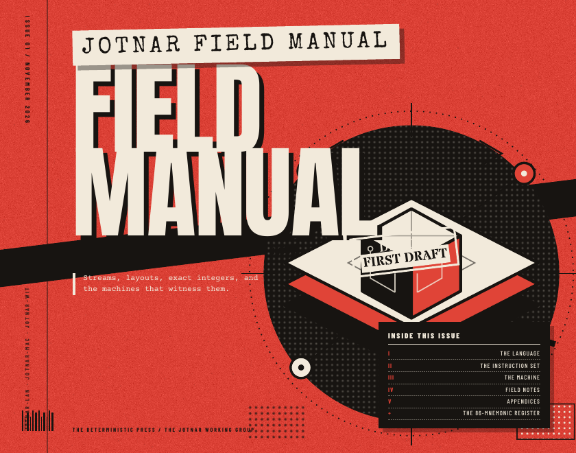
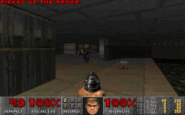
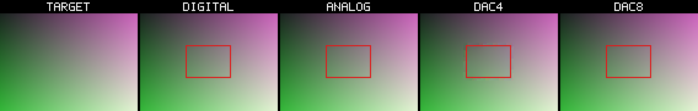

# JOTNAR

**One typed dataflow language. Several exact machines. A witness at every step.**

Jotnar is a different way to think about software. You do not write a sequence
of instructions that mutates a machine. You name typed streams, connect them
into a graph, and ask a machine to realize that graph.

The same graph can run in the reference interpreter, lower to portable C99,
lower to integer-only C, lower to CUDA, become structural Verilog, or drive an
RV32IM machine.

That sounds like portability. The deeper idea is **trust**. A program is a
claim. The machine is a witness. The result is not “it compiled” — it is a
checked realization with a declared boundary.

<table>
<tr>
<td width="42%">
<a href="manual/out/jotnar-field-manual.pdf">

</a>
</td>
<td valign="top">
<h3>Read the field manual</h3>
<p>A zine-style field guide to a language under construction: streams,
layouts, exact integers, machines, negative results, and the discipline
behind the claims.</p>
<p>
<a href="manual/out/jotnar-field-manual.pdf"><strong>PDF</strong></a>
&nbsp;·&nbsp;
<a href="manual/out/manual.html"><strong>HTML</strong></a>
&nbsp;·&nbsp;
<a href="manual/">source</a>
</p>
<p><em>101 pages. 90 mnemonics. One fail-loud rule: if the assembler has to
guess, the program is already wrong.</em></p>
</td>
</tr>
</table>

> A program is a graph wearing the costume of a list.

## Why Jotnar exists

Most systems promise portability by hiding the machine. Jotnar does the
opposite: it makes the machine explicit, then proves that the program survived
the move.

- **Write the graph, not the steps.** Streams are names for values. Shapes
  travel with values. The listing order is for the reader; the dataflow is the
  program.
- **Keep the meaning across targets.** The same listing runs on C, integer-only
  C, CUDA, Verilog, and an RV32IM machine. Integer and triple paths are compared
  exactly; float paths carry an explicit agreement class.
- **Gate the claim.** Every realization has an independent check, a scope, and
  a certificate. “Same bytes” is a stronger promise than “looks right.”
- **Refuse loudly.** Unknown mnemonics, arity mismatches, use-before-def,
  layout conflicts, and shape mismatches are errors, never silent guesses.

This is not a benchmark first. It is a language for people who want to know
what actually ran.

## DOOM runs on a CPU we can describe



This is not a video of DOOM. It is `doomgeneric` compiled for **RV32IM**, running
on a Rust machine model. The first frame costs **24,502,445 guest
instructions**. The frame is byte-identical to the C native core; a checkpoint
resumed to frame 2 is byte-identical to the GPU Jotnar core’s checkpoint and
framebuffer.

That is the interesting part: one binary, one ISA, two engines. The image is
produced by a CPU executing a real program, not by a renderer pretending to be
one.

```sh
./run_doom_demo.sh                 # playable
./run_doom_demo.sh --frames 100    # headless
```

[Behind the scenes](showcase/doom/) · [RV32IM source](src/rv32.rs)

## The analog side



Jotnar can also describe a **field**, not just a tensor. A DAC writes boundary
values, a 2D RC network settles, an ADC reads the result, and a tolerance gate
decides whether the field is admissible. The ideal RC field and digital Laplace
settle to the same harmonic solution; DAC resolution becomes visible as
quantization error.

The live path needs a DAC. A **Refined Jotnar Map** can remove the DAC from the
*application* path by storing the settled field and applying it as a vector.
That is storage and compute separated, not a claim that the live solve is
DAC-free.

This is **Jotnar-SIM**, not **Jotnar-ANA**. It is a digital twin, and it says so.
The analog-filter bake-off goes further and keeps the negative result:

> The best synthetic filter gains about 4% for roughly 10× the solve cost.
> On the real self-occlusion hole it is worse. A local PDE cannot invent the
> missing sphere side.

[Analog field](showcase/analog/) · [Analog filter](showcase/analog_filter/)

## The trust spine

Every exhibit is an instance of the same loop:

```text
construct a small space
  -> propose a candidate
  -> resolve it exactly
  -> gate it independently
  -> keep the certificate
  -> refuse loudly when you cannot
```

A certificate records what it proves **and what it does not prove**. A blocked
run is not a pass. A skipped control is not a pass. A gate that cannot say no is
not a gate.

The self-contained schema example needs no external assets:

```sh
cargo run -p jotnar-lab -- verify certificates/example/certificate.json
```

[The loop](docs/LOOP.md) · [Certificate schema](docs/appendix/TRUST_SPINE.md) · [Harness](crates/jotnar-lab/)

## The nine exhibits

Each one is a different angle on the same stack. The full visual index is
[`showcase/README.md`](showcase/README.md).

| exhibit | the claim |
|---|---|
| [Language tour](showcase/language/) | typed streams, exact arithmetic, composition |
| [Image pipeline](showcase/image/) | one 43-op listing on C / non-FPU / CUDA |
| [Verilog + CPU8](showcase/verilog/) | structural hardware matches an ISA model |
| [Analog field](showcase/analog/) | DAC → RC → ADC matches digital Laplace in the ideal limit |
| [Futhark](showcase/futhark/) | one deterministic inference unit, 118/118 |
| [Protocol](showcase/protocol/) | same bytes under order and placement changes |
| [DOOM](showcase/doom/) | native frame exact; checkpoint frame 2 exact vs GPU |
| [Analog filter](showcase/analog_filter/) | quality and cost, including the negative real-hole limit |
| [Certified agent](showcase/agent/) | exact-gate harness composition; bit-exact backend pipeline with C/non-FPU parity |

## Start here

| if you want to… | go here |
|---|---|
| read the long-form story | [Field manual PDF](manual/out/jotnar-field-manual.pdf) |
| see the language in four listings | `cargo run --release --bin jotnar-demo-tour` |
| watch DOOM run | `./run_doom_demo.sh` |
| see one listing on three targets | `cargo run --release --bin jotnar-demo-img -- --input samples/input_example.png --gallery gallery` |
| understand the trust spine | [docs/LOOP.md](docs/LOOP.md) |
| run the technical commands | [docs/USAGE.md](docs/USAGE.md) |
| read the source | [src/](src/) |
| read the vocabulary | [docs/NOMENCLATURE.md](docs/NOMENCLATURE.md) |

## If you want the machinery

The front door is deliberately short. The actual parts are here:

- assembler, macro expansion, layouts: [`src/asm.rs`](src/asm.rs), [`src/layout.rs`](src/layout.rs)
- the 90-mnemonic registry and reference semantics: [`src/ops/`](src/ops/)
- code generators: [`src/codegen/`](src/codegen/)
- structural Verilog: [`src/verilog.rs`](src/verilog.rs)
- RV32IM and DOOM: [`src/rv32.rs`](src/rv32.rs)
- in-process node protocol: [`src/protocol.rs`](src/protocol.rs)
- certificates and verification: [`crates/jotnar-lab`](crates/jotnar-lab)
- autonomous listing circuit and experience loop: [`crates/jotnar-agent`](crates/jotnar-agent)
- language reference and field notes: [`manual/`](manual/)

## Receipts, not promises

```text
90 mnemonics
88/88 Python-oracle cases (original 86)
4 extension gates (T2I, IGET, IMATMUL, IREDUCE_SUM)
32/32 emitter cases
Futhark 118/118 words
DOOM frame 1 exact vs C native
DOOM frame 2 exact vs GPU checkpoint
61/61 workspace tests
```

These are gates, not a leaderboard. The details and commands are in
[`docs/USAGE.md`](docs/USAGE.md).

## What this is not

- not a general tensor framework
- not a GPU performance claim: the CUDA backend is correctness-first
- not physical analog hardware: the analog work is Jotnar-SIM
- not finished: the device emitter, CUDA fleet kernel, TCP serving, and
  several phi-core modules are still on the bench

The edges are still sharp. That is part of the point.

## License

The Rust implementation is **GPL-3.0-only**, matching upstream Jotnar. The
manual text is **CC BY-SA 4.0**; the manual build code is GPL-3.0-only. See
[`LICENSE`](LICENSE) and [`manual/LICENSE.md`](manual/LICENSE.md).
