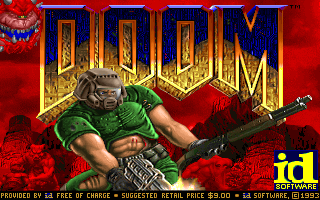
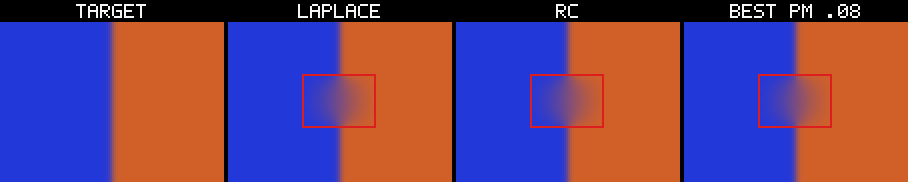

# Jotnar

**One typed dataflow language. Several exact targets. A way to say what a result proves.**

Jotnar is a geometric assembly language. Programs name immutable typed
streams and transform them with a fixed instruction set; shapes and layouts
are checked before execution. The same listing can be:

- executed by the reference interpreter,
- lowered to portable C99,
- lowered to integer-only C with baked lattice tables,
- lowered to CUDA,
- emitted as structural Verilog,
- or used to drive an RV32IM machine.

The point is not one backend. The point is that the **same program survives
all of them**, and that every claim about a run has an independent gate and a
bounded scope.

Read the long-form field manual: [PDF](manual/out/jotnar-field-manual.pdf) · [HTML](manual/out/manual.html).

This is a Rust implementation of **Jotnar-LAN/DIG**. The Python
implementation in [`lostdemeter/jotnar`](https://github.com/lostdemeter/jotnar)
is the oracle. The project follows the fail-loud doctrine: unknown
mnemonics, arity mismatches, use-before-def, layout conflicts, and shape
mismatches are errors, never silent guesses.

## See it in five minutes

Only the language tour and the image demo need a Rust toolchain. The manual is
the long-form companion; `manual/README.md` explains how to rebuild it.

```sh
cargo build --release

# 1. The language in four small listings.
cargo run --release --bin jotnar-demo-tour

# 2. One 43-op listing on C / integer-only C / CUDA.
cargo run --release --bin jotnar-demo-img -- \
  --input samples/input_example.png --gallery gallery

# 3. A real machine: DOOM on the RV32IM core.
./run_doom_demo.sh            # playable; needs the external DOOM assets
./run_doom_demo.sh --frames 100
```

If the DOOM assets are not present, `run_doom_demo.sh` falls back to the
checked-in reference title at `showcase/doom/title.png`. It does not pretend
the live run happened.

The visual index is [`showcase/README.md`](showcase/README.md). Each exhibit
states what it proves and what it does not.

## What a program looks like

```text
IN A
IN X
IN Y

ax = IMUL(A, X)
OUT = IADD(ax, Y)
```

`IN` declares typed streams. `IMUL` and `IADD` are exact integer operations.
`OUT` is an inferred stream. The same text can run in the interpreter or be
emitted to a target; the assembler and layout verifier are the authority.

The instruction registry is `src/ops/mod.rs`; `jotnar ops` prints the
current table. The short vocabulary:

```text
Jotnar-LAN  the program / IR
Jotnar-MAC  the machine or target
Jotnar-WIT  the witness / contract
DIG         digital (exact)
SIM         simulated analog
F / T / I   float / lattice-triple / integer streams
```

See [`docs/NOMENCLATURE.md`](docs/NOMENCLATURE.md) for the full set.

## How it fits together

```text
Jotnar-LAN text
      |
      +-- assembler, DEF/CALL expansion, layout verifier
      |
      +-- interpreter
      +-- C99
      +-- integer-only C
      +-- CUDA
      +-- Verilog
      +-- RV32IM machine / DOOM
      |
      +-- demos, gates, certificates
```

The data/compute vocabulary is separate:

```text
Field -> Map -> Vector -> Plan -> Certificate
```

Fields are state. Maps are stored. Vectors are work. Plans bind them.
Certificates witness the result. The trust-spine appendix explains the
discipline; it is not a language feature.

## Showcase

| exhibit | proves | does not prove |
|---|---|---|
| [Language tour](showcase/language/) | typed streams, exact arithmetic, composition | backend parity, performance |
| [Image pipeline](showcase/image/) | one 43-op listing on C / non-FPU / CUDA | hardware speed |
| [Verilog + CPU8](showcase/verilog/) | structural hardware matches an ISA model | full RTL / all opcodes |
| [Analog field](showcase/analog/) | DAC → RC → ADC matches digital Laplace in the ideal limit | physical analog or geometry completion |
| [Futhark](showcase/futhark/) | one deterministic inference unit, 118/118 | DOM / browser extension |
| [Protocol](showcase/protocol/) | same bytes under order/placement changes | TCP / served backend |
| [DOOM](showcase/doom/) | native frame exact; checkpoint frame 2 exact vs GPU | all programs / plan completeness |
| [Analog filter](showcase/analog_filter/) | quality and simulated cost, including the real-hole negative | analog hardware speed |

Images:

<p>
  
  
</p>

## Trust spine (appendix)

The trust spine is not part of the language. It is the development harness
that records what an exhibit actually proves:

```text
construct a small space -> propose -> resolve exactly
  -> gate independently -> keep the certificate
  -> refuse loudly when you cannot
```

- [`docs/LOOP.md`](docs/LOOP.md) — the normative one-page loop
- [`docs/appendix/TRUST_SPINE.md`](docs/appendix/TRUST_SPINE.md) — schema and first slice
- [`crates/jotnar-lab`](crates/jotnar-lab) — certificates, gates, falsifiers, nulls, benches, verify

The self-contained schema example needs no external assets:

```sh
cargo run -p jotnar-lab -- verify certificates/example/certificate.json
```

The real DOOM certificate references local `/tmp` artifacts. If they are
absent, `verify` prints `BLOCKED` and exits non-zero. That is intentional: a
blocked claim is not a pass.

## Prerequisites

| need | for |
|---|---|
| Rust stable + Cargo | everything |
| `gcc` | C backend, native DOOM core, Verilog test fixture |
| CUDA toolkit + GPU | CUDA target and GPU migration parity |
| SDL2 runtime | playable DOOM window |
| DOOM image + WAD | live DOOM; `run_doom_demo.sh` falls back otherwise |
| Python 3 + NumPy/Pillow | parity harnesses against the Python oracle |
| `jotnar-main` + `phi-core` checkout | differential parity only; demos run without them |

## Build and test

```sh
cargo build --release
cargo test --workspace
```

Targets: `c` (default), `nonfpu`, `cuda`. Add `--fp16` to CUDA builds to
read F inputs from half-precision files (FP32 compute, smaller files).
The CUDA build finds the toolkit relative to `nvcc`; set `NVCC` if it is not
on `PATH`.

## Status and evidence

What works today:

- `IMPORT` / `DEF` / `CALL` textual macro expansion with per-call-site
  namespacing, `REPEAT` / `BREAK`, `CONFIG`, layouts, `STATE`, `RANGE`.
- Registry binding for **all 86 mnemonics**, including `SADD`, `IMAX`,
  `ISAR`, `IDIVU`, `IMODU`, `IEQ`, `ILT`, `ISELECT`.
- The static layout verifier with honest coverage reporting.
- The reference interpreter over `F32`/`F64`, `I64`, `U8`, bool masks,
  lattice triples, and `None` history.
- The lattice substrate (`encode`/`decode`/fixed-point/LUTs) matching the
  Python formulas.
- Three code generators: C99, integer-only C with a float trap, and CUDA.
- Differential parity:

```text
88/88 op cases          scripts/parity_ops.py
32/32 emitter cases     scripts/parity_emit.py
flagship + xf_block     scripts/parity_programs.py
CUDA units/iext/…       scripts/parity_cuda.py
Futhark 118/118         scripts/parity_futhark.py
protocol test suite      cargo test --test protocol
DOOM frame 1 / frame 2   scripts/parity_doom_native.py
workspace tests          61/61
```

Float `F` paths can differ from numpy in the last ulp on some platforms
(different SIMD reduction order); triples and integer paths are compared
bit-exactly.

## Not ported yet

- `jotnar-main`'s **device** emitter and the CUDA fleet kernel used by the
  original DOOM GPU demo. The RV32IM machine, checkpoint/MMIO path, native
  DOOM frame, C/non-FPU/CUDA targets, and Verilog backend are in place.
- TCP transport and serve mode (`live=` resident loops), packed outputs,
  the codec ABI, CUDA graphs, tracing summaries, causal `overrides`, and
  the store-hook fused executor. The in-process frame codec, registry, blob
  shelf, and deterministic EXEC path are in place.
- The model-side phi-core modules (`calibrate`, `score`, `compose`, `stamp`,
  `zoo`); the substrate crate covers the lattice/triple/exact helpers and
  numpy-style ops Jotnar consumes.
- Speed work: the CUDA backend is correctness-first (one launch/op); tuned
  kernels/cuBLAS scheduling is a separate pass.

The Rust SDL player has intermittent frame-time spikes not seen in the
original Python/C player. This is recorded as future work; add a frame-time
trace and p99/max gate before calling the frontend finished.

## CLI

```text
jotnar check  <file.asm> [--stdlib DIR]
jotnar verify <file.asm> [--stdlib DIR] [--json]
jotnar run    <file.asm> --payload FILE [--out FILE] [--outputs a,b] [--stdlib DIR]
jotnar ops
```

```sh
./target/release/jotnar check  programs/xf_block.asm --stdlib stdlib
./target/release/jotnar verify programs/xf_block.asm --stdlib stdlib
./target/release/jotnar run programs/holo_flagship.asm --payload payload.json --out out.json

./target/release/jotnar emit-c programs/xf_block.asm \
  --payload payload.json --outputs OUT --out proj.c
./target/release/jotnar build programs/lm_headt.asm \
  --payload payload.json --outputs LOGITS,OUT --workdir /tmp/headt
./target/release/jotnar build programs/bigram_lm.asm \
  --payload payload.json --outputs OUT --target nonfpu --workdir /tmp/nf
./target/release/jotnar ops
```

`check` parses, expands, and binds. `verify` replays layout unification over
declared layouts and prints the DEF interface table. `run` executes and
writes every stream (or named outputs). `--stdlib DIR` overrides `IMPORT`
search; otherwise the frontend searches the listing directory and ancestors.

## Payload format

JSON is the portable boundary used by the CLI and parity harness:

```json
{
  "streams": {
    "x":  {"kind":"F64","shape":[2,3],"data":[0.1,0.2,0.3,0.4,0.5,0.6]},
    "pos":{"kind":"I64","shape":[2],"data":["0","1"]},
    "rgb":{"kind":"U8","shape":[200,320,3],"data":[0,1,2]},
    "t":  {"kind":"T","shape":[2,2],
           "s":[1,-1,1,1],"e":[30000,31000,32000,33000],"z":[0,0,0,0]}
  }
}
```

Integer entries may be JSON numbers or strings (strings preserve int64
values above 2^53). Output uses the same shape.

`jotnar repeat` threads `STATE` streams across host iterations. The payload
is `{"iterations":[{"streams":{...}},...]}`; non-STATE inputs come from each
iteration, while STATE streams seed from iteration 0 and carry forward.
`--grow a,b` allows append-only growth along axis 0.

## Parity harness

The harnesses need the Python oracle checkout and `phi-core`:

```sh
export PHI_CORE_DIR=/path/to/phi-core
export JOTNAR_PY=/path/to/jotnar

python3 scripts/parity_ops.py --bin target/release/jotnar
python3 scripts/parity_programs.py --bin target/release/jotnar
python3 scripts/parity_emit.py --bin target/release/jotnar
python3 scripts/parity_cuda.py --bin target/release/jotnar   # nvcc/GPU
python3 scripts/parity_futhark.py
python3 scripts/parity_doom_native.py --gpu-work /tmp/opencode/doom_overlay
```

## Layout

```text
src/
  asm.rs        IMPORT/DEF/CALL expansion, REPEAT, parse, assemble, verify
  ir.rs         Config, IN declarations, instructions, bound program
  layout.rs     KIND:GEOM layouts and $VAR / $VAR^T / * unification
  value.rs      Value (F32/F64/I64/U8/Bool/Triple/None) and Arg literals
  lattice.rs    phi lattice: encode/decode, fixed point, frozen LUTs
  ops/          mnemonic registry + reference semantics
    int.rs      exact integer arithmetic and F2I/I2F
    element.rs  triples arithmetic, sigmoid, clip, mux
    linalg.rs   matmul, norms, softmax, RoPE, attention, moves
    bytes.rs    IWINDOW/IGATHER1/CRC/inflate/varint
    image.rs    sRGB, luma, gain, splat blur, conv/deconv, warp
  codegen/      backend drivers
    infer.rs    static shapes/dtypes for codegen
    c.rs        C99 patterns
    nonfpu.rs   integer-only patterns + baked tables + float trap
    cuda.rs     CUDA kernels and driver
  rv32.rs       RV32IM machine + DOOM MMIO/checkpointing
  protocol.rs   in-process node protocol + frame codec
  showcase/     demos: language, image, Futhark, protocol, analog, DOOM
crates/phi-core/
  src/lattice.rs   the phi lattice substrate
  src/triple.rs    typed (s,e,z) stream value
  src/ops.rs       exact compare/clip/bin helpers
  src/numpy_ops.rs matmul/norms/softmax/gelu/scan substrate ops
manual/          field manual source, PDF/HTML, press, assets
crates/jotnar-lab/ trust-spine certificate/gate/verify harness
showcase/        curated visuals and per-exhibit READMEs
certificates/    checked-in certificate examples
tests/           frontend/runtime/RV32/protocol/certificate tests
scripts/         Python differential parity harnesses
docs/LOOP.md     normative trust-spine appendix
docs/PORTING.md  port map and milestones
docs/PORT_BACKLOG.md curated port/demo plan
```

## Licensing

GPL-3.0-only, matching the upstream project. This is a derivative work of
Jotnar; see `LICENSE`.
