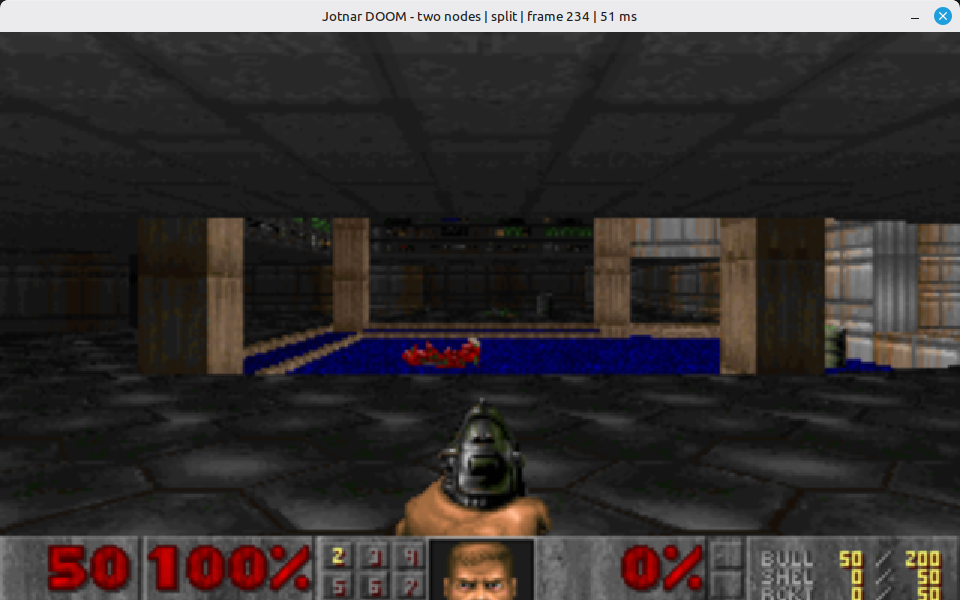

# DOOM across two nodes

**Status:** cooperative per-frame pipeline with measured split, interactive
viewer, and single-node failover; GIF recorded on the live CUDA + HIP fleet
**Artifact:** [`showcase/doom/doom_two_nodes.gif`](../showcase/doom/doom_two_nodes.gif)

## Shape

```text
node A (coordinator host)            node B (CUDA)             node C (HIP)
  RV32IM native core                   Jotnar INTERP 2x          Jotnar INTERP 2x
  framebuffer 320x200 BGRA   ->        left window        ->     right window
        |                                   |                         |
        +-------- frame windows over TCP ---+                         |
        |                                                             |
        +<--------------- RGB results -------------------------------+
        |
  crop/stitch -> 640x400 RGB -> raw frames + latency metadata -> GIF
```

Node A runs the responsive native RV32IM core. Nodes B and C each run the same
Jotnar listing on one overlapping window of the frame. The coordinator
calibrates both cards and chooses the window widths from measured throughput;
on this fleet CUDA gets about 32% of the columns and HIP about 68%. The
overlap keeps the bilinear upscale continuous at the split.

## Why two nodes

This is the first test where the nodes cooperate on **one frame**, not just
hand a checkpoint from one to the other:

- the game state stays on node A;
- each GPU node does real Jotnar work every frame;
- the coordinator owns placement, frame splitting, stitching, and the
  latency receipt;
- the executor contract is unchanged: `submit`, `job-status`, `job-result`.

It is a streaming coordinator above the same executor contract, not a new
model or stage format.

## Listing

[`showcase/doom/upscale-half.asm`](../showcase/doom/upscale-half.asm):

```text
CONFIG warm_frame 1
IN X
OUT = INTERP(X, 2.0, 2.0)
```

`CONFIG warm_frame 1` keeps the GPU context, compiled artifact, and buffers
resident. The per-frame cost is the Jotnar op plus copies, not process
startup. The runner reports the F32 output descriptor and binary body; the
coordinator validates it before use.

## Commands

```sh
cargo build --release -p jotnar-node-tools --bin jotnar-doom-coord

./target/release/jotnar-doom-coord \
  --image "$HOME/Documents/OpenCode/jotnar-main/programs/doom/build/doom.bin" \
  --wad "$HOME/Documents/OpenCode/jotnar-assets/doom1.wad" \
  --cuda 192.168.1.116:9997 \
  --hip 192.168.1.195:9997 \
  --token test \
  --start-frame 200 --frames 60 --fps 15 \
  --out /tmp/opencode/doom_two_nodes
```

`--no-auto-split` forces the even 160/160 split for comparison. The
reproducible gate also annotates the frames and writes the GIF:

```sh
python3 scripts/doom_two_gpu_gate.py
```

## Interactive viewer

Start the coordinator with a viewer listener and open the SDL window on this
machine:

```sh
./target/release/jotnar-doom-coord \
  --image "$HOME/Documents/OpenCode/jotnar-main/programs/doom/build/doom.bin" \
  --wad "$HOME/Documents/OpenCode/jotnar-assets/doom1.wad" \
  --cuda 192.168.1.116:9997 --hip 192.168.1.195:9997 \
  --token test --start-frame 200 --frames 10000 --fps 20 \
  --viewer-listen 127.0.0.1:10000 \
  --out /tmp/opencode/doom_live

./target/release/jotnar-doom-view --addr 127.0.0.1:10000
```

The viewer loads SDL2 through its C ABI. It displays the stitched 640x400
frame in a 960x600 window, puts the current mode/frame/latency in the title
bar, and forwards key events to the coordinator over TCP. Arrows move, ctrl
fires, space uses, shift runs, esc opens the menu, and q quits.

The coordinator runs the RV32IM core and the GPU pipeline; the viewer only
displays and forwards keys. The startup script still advances to gameplay, so
the viewer can connect before or during the run.



## Failover

Both nodes pre-warm a full-frame fallback shape at startup. If a node fails,
the coordinator marks it down, records the error, and retries that frame on
the surviving node with the full 320-column input. Later frames stay in
single-node mode. The RV32IM loop and the frame writer keep running.

The reproducible outage gate uses local TCP proxies in front of the real GPU
runners, then closes one proxy mid-run:

```sh
python3 scripts/doom_failover_gate.py
```

Checked results:

```text
CUDA outage  -> hip-full   p50 47 ms, p95 52 ms, 45/45 frames, exit 0
HIP outage   -> cuda-full  p50 120 ms, p95 137 ms, 45/45 frames, exit 0
```

The HIP outage is slower because CUDA is slower on this op, but the run still
completes and the coordinator does not crash. The failover event includes the
frame, failed node, error, and action.

## Receipt

The checked adaptive run:

```text
node A  RV32IM native        core p50 32 ms
node B  CUDA 192.168.1.116   p50 40 ms
node C  HIP  192.168.1.195   p50 26 ms
total                        p50 40 ms, p95 45 ms
frame budget at 15 fps       66 ms
real time at target          yes
split                        101 CUDA / 219 HIP columns (32% / 68%)
frames                       60
warmup                       CUDA 6644 ms, HIP 2316 ms (first run)
```

The calibration probes the even split three times and uses the median:

```text
CUDA probe p50  41 ms
HIP  probe p50  19 ms
chosen split    101 / 219
```

The GIF is 640x454 (640x400 frame plus a HUD), 60 frames, 15 fps. The HUD
shows the frame number, the measured CUDA/HIP split, per-card latency, and the
frame budget.

The coordinator writes:

```text
run.json        hashes, node addresses, split, calibration, latency p50/p95/max
frames.jsonl    one record per frame: input keys, per-card job ids/timings/hashes
frames/*.rgb    raw 640x400 RGB frames
poster.png      annotated first frame
contact.png     six-frame contact sheet
```

The checked evidence is copied to
`/home/balrog/Documents/OpenCode/jotnaros/artifacts/doom-two-nodes/`:

```text
run.json, frames.jsonl, hardware.json, poster.png, contact.png
viewer.png, viewer-key-test.jsonl
viewer-failover.png
failover/summary.json, failover/cuda-outage.log, failover/hip-outage.log
```

## Limits

- The GPU op is a 2x bilinear upscale, not a full distributed renderer. The
  RV32IM renderer still runs on node A.
- The split is chosen at startup from a calibration probe. It does not yet
  rebalance mid-run or recover a failed node.
- Failover switches to a single node for the rest of the run. The full-frame
  fallback is pre-warmed, so the surviving node does not pay artifact build in
  the failover frame.
- The viewer protocol is a simple length-prefixed frame stream and JSON key
  messages; it has no authentication beyond the trusted-LAN assumption.
- The coordinator is DOOM-specific. A general streaming stage ABI is future
  work; the batch bundle/stage layer is separate.
- The first frame pays artifact build and warm-worker startup. The receipt
  separates warmup from steady-state latency.
- The 64 MB RV32IM state is not moved between nodes in this demo; only frame
  pixels move. Checkpoint migration is the separate two-node gate.
- The trusted-LAN token is not TLS.
