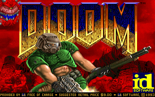
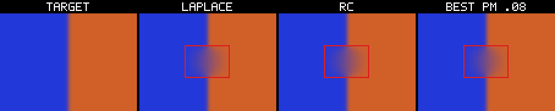

# Showcase

Each exhibit is a separate claim. The one-line rule is:

> A demo shows what it proves **and** what it does not prove.

The full certificate/schema story is in the trust-spine appendix
([`../docs/LOOP.md`](../docs/LOOP.md)).

## First look

| | |
|---|---|
| **DOOM** |  |
| **Analog filter** |  |

## The nine exhibits

### 1. Language tour

Four tiny listings: elementwise arithmetic, reduction, a shared operand
graph, and an exact predicate/select.

```sh
cargo run --release --bin jotnar-demo-tour
```

Proves: streams, shapes, exact integer arithmetic, and composition.
Does not prove: backend parity or performance.

### 2. Image pipeline on three targets

One 43-op listing, the same text on C, integer-only C, and CUDA.

```sh
cargo run --release --bin jotnar-demo-img -- \
  --input samples/input_example.png --gallery gallery
```

Images: [`image/input.png`](image/input.png),
[`image/c_strip.png`](image/c_strip.png),
[`image/cu_us.png`](image/cu_us.png),
[`image/nf_us.png`](image/nf_us.png).

Proves: the same listing produces matching images across targets.
Does not prove: hardware speed or every opcode on every backend.

### 3. Verilog + CPU8

The integer subset emitted as structural Verilog, then simulated against the
independent CPU8 ISA model.

```sh
cargo run --release --bin jotnar-verilog -- \
  tests/fixtures/cpu8.asm --config showcase/verilog/cpu8.json --module cpu8
```

Proves: the language can describe a sequential machine and the emitted
structure matches the ISA model.
Does not prove: a full RTL toolchain or all opcodes.

### 4. Jotnar-SIM analog field

DAC → 2D RC field → ADC, with a tolerance gate and a baked-map profile.

```sh
cargo run --release --bin jotnar-demo-analog -- --out showcase/analog/out
```

Image: [`analog/panel.png`](analog/panel.png).

Proves: the field solve matches digital Laplace in the ideal limit; the
DAC/ADC/tolerance story is observable.
Does not prove: physical analog hardware or geometry completion.

### 5. Futhark as one inference unit

One word is one request to one Jotnar listing: lexicon fingerprint lookup,
compiled spelling rules, phoneme → rune table.

```sh
python3 scripts/build_futhark_payload.py --no-contractions --out showcase/futhark/payload
cargo run --release --bin jotnar-demo-futhark -- \
  --payload showcase/futhark/payload --corpus showcase/futhark/corpus.txt
```

Proves: a trained lexicon and rule table run as one deterministic Jotnar
unit, 118/118 against the original JavaScript rule engine.
Does not prove: the browser extension, DOM, or arbitrary contractions.

### 6. Ordering / determinism without sockets

Model-blind lattice nodes run independent jobs in changing orders and
placements; completion order changes; output bytes do not.

```sh
cargo run --release --bin jotnar-demo-protocol
```

Proves: same program + same input bytes = same output bytes regardless of
placement or completion order.
Does not prove: TCP transport, multi-stage pipelines, or the `served`
backend.

### 7. DOOM on RV32IM

A real compiled DOOM image on a 32-bit RISC-V machine model. Playable by
default; frame-count headless mode for a repeatable run.

```sh
./run_doom_demo.sh
./run_doom_demo.sh --frames 100
```

Image: [`doom/title.png`](doom/title.png).

Proves: frame 1 matches the C native core; the Rust frame-1 checkpoint
resumed to frame 2 matches the GPU Jotnar checkpoint and framebuffer.
Does not prove: the GPU fleet kernel for all programs, plan completeness, or
memory beyond the modeled 64 MB.

### 8. Analog filter: quality, cost, limits

Laplace/RC vs Perona–Malik, with a synthetic edge and the real-hole negative
kept explicit.

```sh
cargo run --release --bin jotnar-demo-analog-filter
```

Image: [`analog_filter/edge_panel.png`](analog_filter/edge_panel.png).

Proves: the best synthetic PM gain is about 4% relative for about 10× the
Laplace cost; on the real hole it is worse.
Does not prove: analog hardware speed or that a local PDE replaces geometry.

### 9. Certified harness tuning (`jotnar-agent`)

A bounded proposer edits a harness of composable families and steps; the exact
interpreter gate is the only judge. The demo composes two independent fixes,
retains the incumbent, checks a held-out split, and audits a separate hard set.
The backend showcase applies the same loop to a real integer-IR optimizer
pipeline and verifies C and non-FPU parity.

```sh
cargo run -q -p jotnar-agent -- demo --out runs/demo
cargo run -q -p jotnar-agent -- backend-showcase --out runs/backend-showcase
```

Proves: composition under an exact gate; retention and held-out
non-regression; per-case certificates; a bit-exact backend pipeline with C and
non-FPU parity (train ops 27 -> 20, weighted 58 -> 35; held-out ops 13 -> 11,
weighted 33 -> 23; 0 regressions).
Does not prove: open-ended self-improvement, universal equivalence, or hardware
performance. Read the full claim in
[`agent/README.md`](agent/README.md).

## Trust spine

The certificate harness lives in [`../crates/jotnar-lab`](../crates/jotnar-lab).
The self-contained schema example verifies with no external assets:

```sh
cargo run -p jotnar-lab -- verify certificates/example/certificate.json
```

The DOOM certificate is real but references local `/tmp` artifacts; if they
are absent, `verify` says `BLOCKED`, not `PASS`. That is the point.
