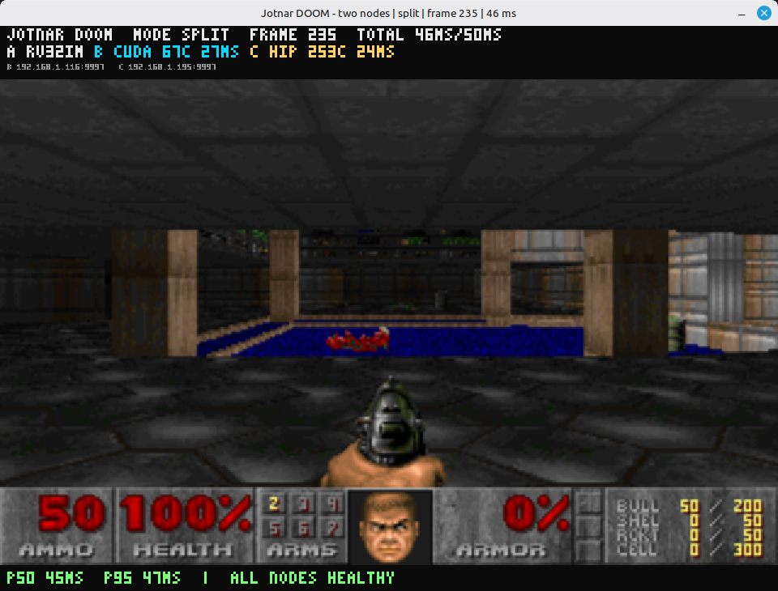
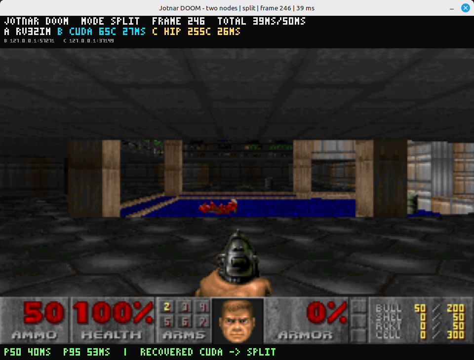

# DOOM on the RV32IM Jotnar core

This is the third second-leg exhibit: a real compiled program on a real
machine model. It is **RV32IM**, a 386-class 32-bit CPU — not x86, not DOS,
and not a 386 emulator.

```text
doomgeneric (C)
  -> Zig clang/lld, riscv32-freestanding -mcpu=generic_rv32+m
  -> flat RV32IM image (847,112 bytes)
  -> RV32IM machine model
  -> 320x200 RGBA framebuffer
```

The Rust core lives in `src/rv32.rs`; the runner is
`src/bin/jotnar-demo-doom.rs`.

## One command for everyone

```sh
./run_doom_demo.sh
```

The default is **playable DOOM** in a 960×600 window, running on the Rust
RV32IM core. Arrows move, ctrl fires, space uses, shift runs, esc opens the
menu, and q quits.

Headless frame runs use a frame count:

```sh
./run_doom_demo.sh --frames 100
./run_doom_demo.sh --no-open        # same as --frames 1
```

The script finds the DOOM assets, builds the Rust core, and opens the
window. If no display is available it falls back to a headless frame.

## Player

The player is `src/bin/jotnar-doom-player.rs`. It uses the same Rust core and
loads SDL2 through its C ABI, so no SDL headers or Rust SDL crate are needed.

## Run frame 1

Assets are external to this repo:

```sh
cargo run --release --bin jotnar-demo-doom -- \
  --image "$HOME/Documents/OpenCode/jotnar-main/programs/doom/build/doom.bin" \
  --wad   "$HOME/Documents/OpenCode/jotnar-assets/doom1.wad" \
  --frames 1 \
  --out /tmp/opencode/doom_rust/frame1 \
  --compare /tmp/opencode/doom_demo/frame1.fb
```

Reference result:

```text
frame 1: 24502445 instructions, pc=0x00048860
framebuffer: BYTE-IDENTICAL
```

The native C core produces the same instruction count, PC, registers,
first 64 MB of memory, and framebuffer.

## Two-node cooperative frame path

The next step after checkpoint handoff is per-frame cooperation. The RV32IM
core runs on node A; the CUDA and HIP runners are nodes B and C. Each GPU gets
one overlapping horizontal window of the framebuffer and runs the same Jotnar
program (`upscale-half.asm`: `INTERP(X, 2.0, 2.0)`). The coordinator stitches
the two results into one 640x400 frame.

The split is not fixed. The coordinator probes both cards on the same frame,
then gives each side columns proportional to measured throughput. On the live
fleet CUDA is slower for this op, so the run chooses about 32% CUDA / 68% HIP
instead of 50/50.

```sh
cargo build --release -p jotnar-node-tools --bin jotnar-doom-coord
python3 scripts/doom_two_gpu_gate.py
```

The gate writes [`doom_two_nodes.gif`](doom_two_nodes.gif) and records
per-frame latency. The checked adaptive run:

```text
node A  RV32IM native        core p50 33 ms
node B  CUDA 192.168.1.116   p50 29 ms
node C  HIP  192.168.1.195   p50 26 ms
total                        p50 42 ms, p95 44 ms
frame budget at 15 fps       66 ms
real time at target          yes
split                        72 CUDA / 248 HIP columns
```

The warm worker removes process startup from the per-frame path. The first
job still pays artifact build/worker startup (about 6.6 s CUDA and 2.3 s HIP
on this fleet); later frames are the Jotnar op plus buffer copies. The two
windows overlap by one input column so bilinear upscaling stays continuous at
the split.

This is the first cooperative streaming path: the game core and the Jotnar
program run on different nodes, and the coordinator measures the cost of
moving a frame between them. The placement model behind the split is described
in [`docs/WORKLOAD_COORDINATION.md`](../../docs/WORKLOAD_COORDINATION.md). It
is not yet a general streaming workload contract; the batch bundle/stage layer
is documented in
[`docs/WORKLOAD_CONTROLLER.md`](../../docs/WORKLOAD_CONTROLLER.md).

### Play it on this machine

Start the coordinator with a viewer listener, then open the SDL viewer:

```sh
./target/release/jotnar-doom-coord \
  --image "$HOME/Documents/OpenCode/jotnar-main/programs/doom/build/doom.bin" \
  --wad "$HOME/Documents/OpenCode/jotnar-assets/doom1.wad" \
  --cuda 192.168.1.116:9997 --hip 192.168.1.195:9997 \
  --token test --start-frame 200 --frames 10000 --fps 20 \
  --viewer-listen 127.0.0.1:10000 --out /tmp/opencode/doom_live

./target/release/jotnar-doom-view --addr 127.0.0.1:10000
```

The viewer displays the stitched frame and forwards keys to the RV32IM core.
A live HUD shows the active mode, frame, total/budget latency, the RV32IM node,
both GPU nodes with columns and per-node latency, rolling p50/p95, and
failover/recovery state. Arrows move, ctrl fires, space uses, shift runs, esc
menu, q quits.



### Network outage and recovery

Both nodes pre-warm a full-frame fallback. If one node disappears, the
coordinator marks it down and finishes the frame on the survivor. Every
`--recover-every` frames it pings the failed node; if it answers, it warms the
split shapes and returns to split mode.

```sh
python3 scripts/doom_failover_gate.py
```

Checked results:

```text
CUDA outage  -> hip-full   p50 47 ms / p95 59 ms, 45/45 frames
HIP outage   -> cuda-full  p50 119 ms / p95 126 ms, 45/45 frames
CUDA recover -> split      p50 43 ms / p95 54 ms, 1 recovery
HIP recover  -> split      p50 49 ms / p95 120 ms, 1 recovery
```



## Checkpoint / migration gate

```sh
python3 scripts/parity_doom_native.py --gpu-work /tmp/opencode/doom_overlay
```

With the CUDA overlay present, the gate proves:

```text
frame1-mem64: OK
frame1-x: OK
frame1-pc: OK
frame1-cyc: OK
frame1-fb: OK
frame2-mem64: OK
frame2-x: OK
frame2-pc: OK
frame2-cyc: OK
frame2-fb: OK
gpu-frame2-mem64: OK
gpu-frame2-x: OK
gpu-frame2-pc: OK
gpu-frame2-fb: OK
RESULT: ALL OK
```

That means the Rust core's frame-1 checkpoint can be resumed by the C
native core, and the frame-2 state is byte-identical to the GPU Jotnar
core's checkpoint and framebuffer.

## Known issue — player frame spikes

The Rust player has intermittent frame-time spikes that were not observed in
the original Python/C player. It is playable, but not yet smooth enough to
call finished. Future work:

- record a frame-time trace (`Instant` around step loop, texture update,
  render, event poll, sleep) instead of judging by eye;
- compare against the same trace from the original ctypes player;
- check whether the spikes come from SDL texture upload/present, the
  64 MB-vs-128 MB memory layout, timer/clock handoff, or host scheduling;
- add a p99 / max-frame-time gate once the cause is known.

This is a player issue, not a RV32 core exactness issue: frame 1/2 state and
framebuffer bytes still gate against the C and GPU references.

## What is ported, and what is not

Ported to Rust:

- RV32I + M interpreter, including the spec edge cases for multiply/divide
- CSR/Sv32 surface and traps used by the freestanding runtime
- DOOM MMIO: WAD, framebuffer, clock, frame counter, key ring, UART/CLINT
- checkpoint save/load
- framebuffer PNG and raw output
- frame-1 and frame-2 exactness against the existing native and GPU demos

Not ported:

- the CUDA `rv32_kernel.cu` fleet kernel
- the playable SDL2 frontend
- the full DOOM toolchain (the 847 KB image is the artifact we run)

The Rust binary is the native exact core; the existing CUDA overlay remains
the GPU witness. The important migration contract is verified: the modeled
64 MB machine state is portable and byte-exact.
