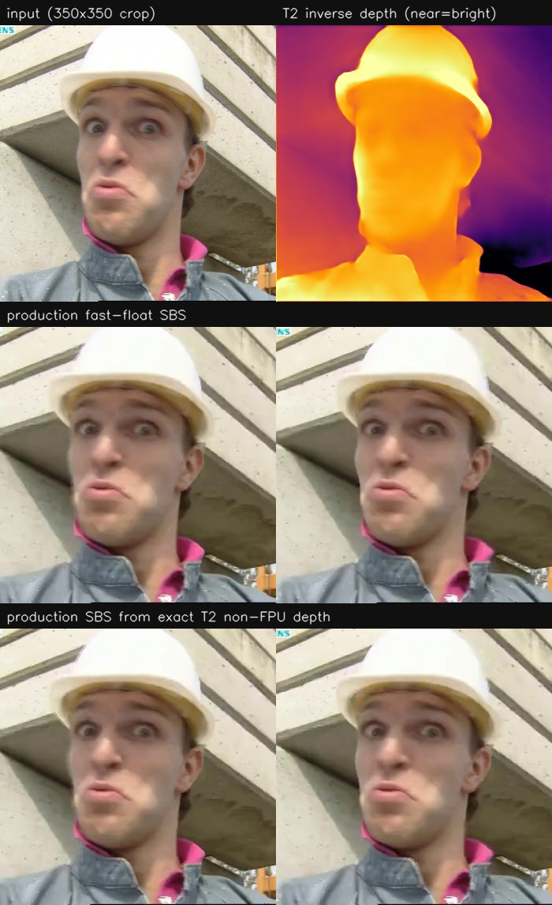

# Companion showcase: T2 non-FPU DAV2 depth



> **Status: companion showcase, not one of the ten language-repo exhibits.**
> The language/runtime gates for the T2 support are in this repository. The
> full-depth, profile, and FPS numbers are **application-level evidence** from
> the companion depth-conversion repository and are not reproducible from this
> repository alone. The companion repository is currently local-only; no
> companion certificate or model scripts are checked in here.
>
> **Claim boundary (explicit).** The language repository does not certify
> these full-depth or FPS numbers. This companion section is documentation of
> an external, non-reproducible application claim, accepted only with that
> boundary; it is not a language-repo gate. The formal statement and accepted
> boundary are in [`CLAIM_BOUNDARY.md`](CLAIM_BOUNDARY.md).

The input is this repository's existing `showcase/image/input.png`, cropped to
350×350. The panel is illustrative; the gate numbers below are from the
canonical 112/518 application runs, not from the panel crop.

## Language-gated by this repository

These are the only claims a reviewer can reproduce from this branch:

- T2 image ops `CONV2D`, `DECONV2D`, `RESIZE2D`, `RELU` and seam moves
  `SLICE`, `RESHAPE2`, `RESHAPE3` are **bit-identical on all four planes**
  to the T2 interpreter.
- `CONFIG threads N` (1..=256; 0 typed) emits OpenMP over T2 `MATMUL`
  rows and produces identical T2 output.
- Gates: **231/231 workspace tests**, **26/26** Rust parity, fmt clean.

```sh
cargo test --test nonfpu_t2
cargo test -p phi-core t2::
cargo test --workspace -- --test-threads=1    # 231/231
python3 scripts/parity_rust.py --bin target/debug/jotnar   # 26/26
```

## Application-reported (external, companion repository)

The composed DAV2-Small full depth (backbone → seam → neck → head) was
measured by the companion application with the production checkpoint
`dav2s_mixed_far_best.pt` on a real frame. This is the **single canonical
number set**; do not duplicate a second set elsewhere.

| measurement | corr | max | mean |
|---|---|---|---|
| T2 full depth vs float, 112×112 | 0.999983028 | 4.36e-3 | 1.07e-4 |
| T2 full depth vs float, 518×518 | 0.999994052 | 1.42e-2 | 4.04e-4 |
| fast-float vs T2 full depth, 518×518 | 0.999999910 | 7.74e-3 | 5.26e-5 |

Profile boundary:

- **Production default: fast-float.** Torch/CUDA, 75.4 fps at 518 px,
  `non-FPU: NO`, explicitly **WAIVED**. Its agreement with the T2 canary is
  measured above; it is still a declared tradeoff.
- **fast-int:** exact T2 with OpenMP; 12-block 518 px backbone 310.7 s → 29.0 s
  on 16 threads, identical output. No accuracy waiver.
- **T2 reference/canary:** exact non-FPU, 166 s/frame end to end at 518 px on
  16 threads. Offline/canary, not live.
- Production SBS (depth + temporal + JBU + warp/fill + encode) measured
  7.3 fps at 518 px and 12.2 fps at 336 px; live webcam depth/SBS preview
  12.9 fps (camera-bound). These are application-level performance numbers.

## What this does not prove

- That the companion full-depth and FPS numbers can be reproduced from this
  repository alone.
- That temporal/calibration/JBU/disparity limiting/provenance inpaint are in
  this repository or the Rust host.
- That exact T2 is live: 166 s/frame at 518 px is offline.
- That `fast-float` is non-FPU: it is explicitly waived.
- That the Rust target accepts T2: it refuses by design; T2 lowers to NonFpu C.

## Boundary

This directory is linked from the **Companion showcases** section of
[`../README.md`](../README.md), not counted among the ten language exhibits.
When the companion application is published with its fidelity cards and
reproduction commands, this can be promoted to a numbered exhibit after the
root README, `docs/LOOP.md`, manual showcase chapter, and manual rebuild are
all updated together.
